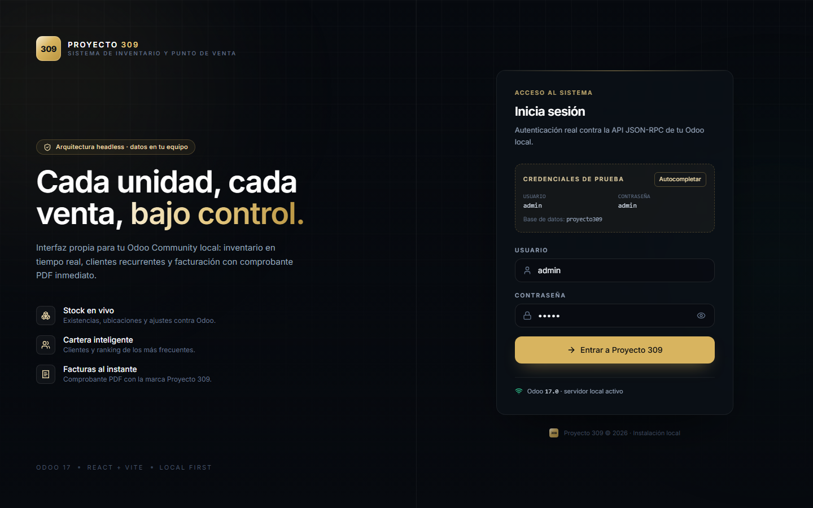

# Proyecto 309 — Inventario & POS

Sistema de inventario y punto de venta **headless** para uso local:

- **Cerebro:** Odoo Community 17 (JSON-RPC).
- **Skin:** React 18 + Vite + TypeScript + Tailwind CSS + Framer Motion.
- **PDF:** factura generada en el navegador con jsPDF (sin servidor de reportes).



## Estructura

```
proyecto-309/
├── docker-compose.yml            # Odoo 17 + PostgreSQL 15
├── frontend/
│   ├── src/lib/odoo/             # cliente JSON-RPC y servicios (auth, inventario, clientes, ventas)
│   ├── src/lib/pdf.ts            # generador de la factura PDF con marca Proyecto 309
│   ├── src/pages/                # Login · Inventario · Clientes · Facturación
│   ├── src/components/           # AppShell, UI, marca
│   └── scripts/                  # smoke tests (UI con datos mock, PDF)
└── docs/                         # capturas y factura de ejemplo
```

## Puesta en marcha

Requisitos: Docker Desktop, Node.js 20+.

```powershell
# 1. Infraestructura (desde proyecto-309)
docker compose up -d

# 2. Crear la base e instalar los módulos que usa la app
docker compose exec odoo odoo -d proyecto309 -i stock,sale_management,account,l10n_bo --without-demo=all --stop-after-init

# 3. Cargar el plan contable boliviano (una sola vez, ver abajo)
# 4. Frontend
cd frontend
npm install
npm run dev
```

Abre <http://localhost:5173>. Credenciales de prueba: **admin / admin** (base `proyecto309`).

### Plan contable de Bolivia

`l10n_bo` instala la localización, pero **no carga el plan contable por sí solo** en una base creada por CLI. Hay que cargarlo una vez:

1. Entra a Odoo (`http://localhost:8069`) como `admin`.
2. **Ajustes → Compañías → Mi compañía**: País = *Bolivia*, Moneda = *BOB* → Guardar.
3. **Contabilidad → Configuración → Ajustes → Localización fiscal**: paquete *Bolivia* → Guardar. Odoo crea plan de cuentas, impuestos y diarios.

Verificación: **Contabilidad → Configuración → Plan contable** debe listar cuentas de 6 dígitos y **Diarios** debe incluir *Facturas de cliente*.

> Alternativa por consola (misma operación, sin UI):
> ```powershell
> docker compose exec odoo odoo shell -d proyecto309
> ```
> ```python
> company = env.company
> company.write({'country_id': env.ref('base.bo').id,
>                'currency_id': env['res.currency'].search([('name', '=', 'BOB')], limit=1).id})
> env['account.chart.template'].try_loading('bo', company)
> env.cr.commit()
> exit()
> ```

Si prefieres un plan genérico en lugar del boliviano, instala `l10n_generic_coa` y elige ese paquete. Si ya creaste la base solo con `base`, el comando 2 agrega los módulos sin borrar datos.

> Si el puerto 8069 está ocupado, cambia el mapeo en `docker-compose.yml` y el `proxy` de `frontend/vite.config.ts`.

## Variables de entorno

Copia `frontend/.env.example` a `frontend/.env` si necesitas otros valores. Por defecto la app usa `/odoo` como prefijo, que el proxy de Vite redirige a `http://localhost:8069` (Odoo no envía cabeceras CORS).

## Funcionalidad

| Apartado | Incluye |
| --- | --- |
| Login | Autenticación real (`common.login`), microinteracciones Framer Motion, credenciales demo visibles, estado de conexión |
| Inventario | Productos con cantidad a mano/disponible, búsqueda, filtro con stock, ubicaciones internas y ajuste de inventario (`stock.quant` + `action_apply_inventory`) |
| Clientes | Listado `res.partner`, ranking por `sale_order_count`, alta rápida con validación |
| Facturación | POS con carrito, selector de cliente, emisión de `account.move` + `action_post` y descarga inmediata del PDF |
| PDF | A4 con cabecera de marca, datos del cliente, ítems, totales de Odoo, notas, firma y paginación |

## Arquitectura y decisiones

- **Sesión:** `uid` + contraseña en memoria; se persiste en `sessionStorage` (nunca `localStorage`) y se rehidrata al recargar.
- **Totales:** el frontend solo muestra un subtotal estimado; los importes definitivos (impuestos incluidos) son los que devuelve Odoo tras publicar la factura.
- **Ajustes de stock:** se aplican como inventario físico, no como recepción con picking. Es el camino más ligero y mantiene trazabilidad en Odoo.
- **PDF:** `jsPDF` + `jspdf-autotable` se cargan con `import()` dinámico (~400 kB) solo al generar un comprobante.
- **Sin addons personalizados:** todo el contrato vive en el cliente JSON-RPC, así el backend se actualiza sin tocar el frontend.

## Scripts

```powershell
npm run dev         # desarrollo (proxy a Odoo en :8069)
npm run build       # typecheck + build de producción
npm run typecheck   # solo TypeScript
npm run test:ui     # smoke de UI con JSON-RPC simulado (Edge headless) + capturas
npm run pdf:sample  # genera docs/factura-ejemplo.pdf sin Odoo
```

`test:ui` necesita el dev server en `http://localhost:5183` (`npm run dev -- --port 5183`) y usa el Edge instalado.

## Limitaciones conocidas

- La integración se validó con build de producción y un servidor JSON-RPC simulado; falta la prueba de extremo a extremo contra el contenedor real.
- El ajuste de stock no descuenta reservas de pedidos pendientes.
- El PDF es un comprobante de la factura de Odoo; no sustituye el reporte oficial ni incluye logo de la compañía (usa la marca Proyecto 309).
